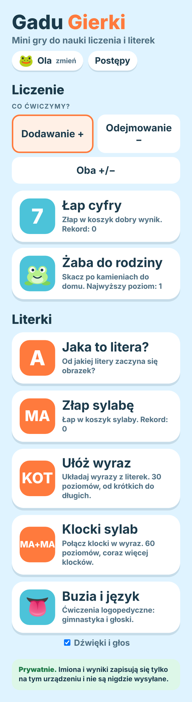
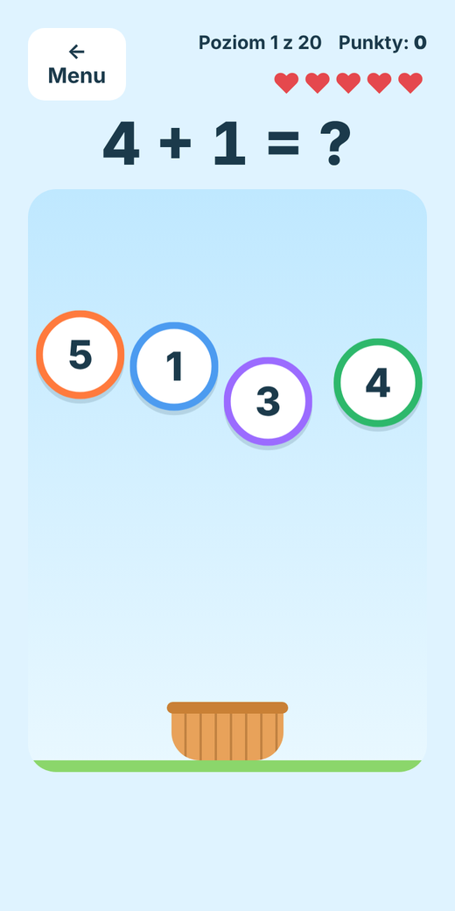
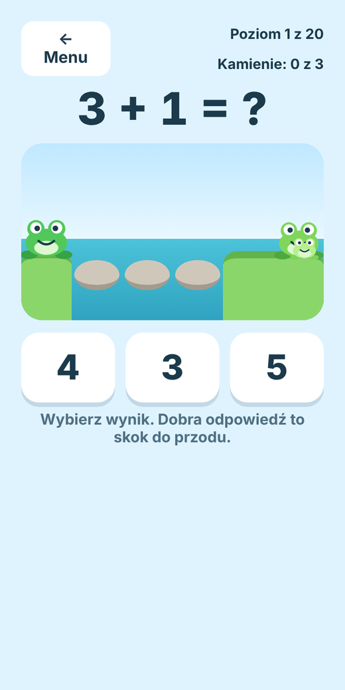
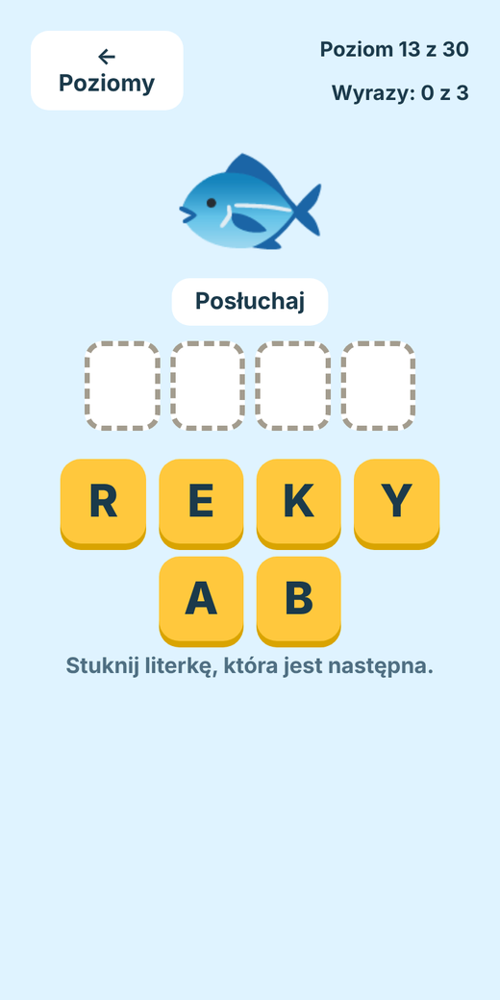
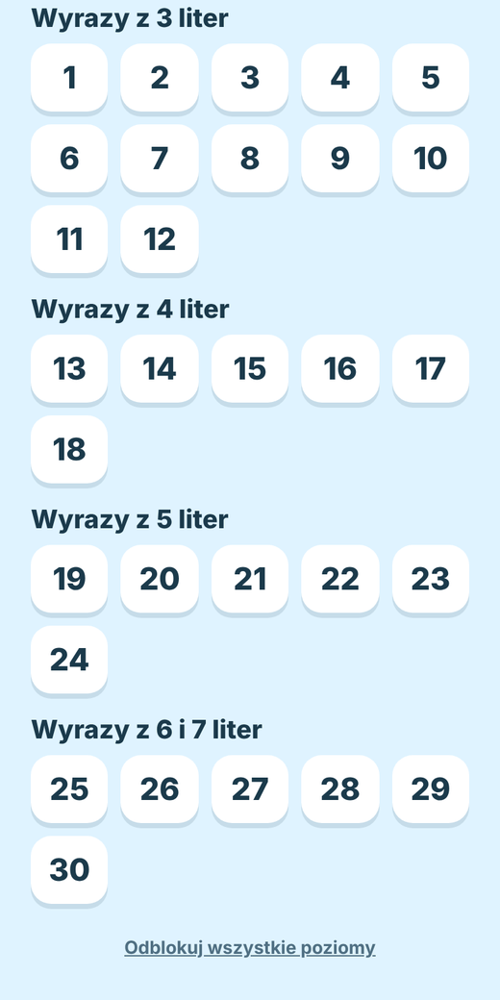
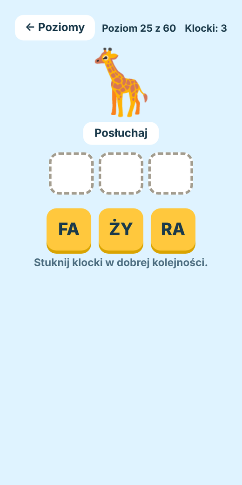
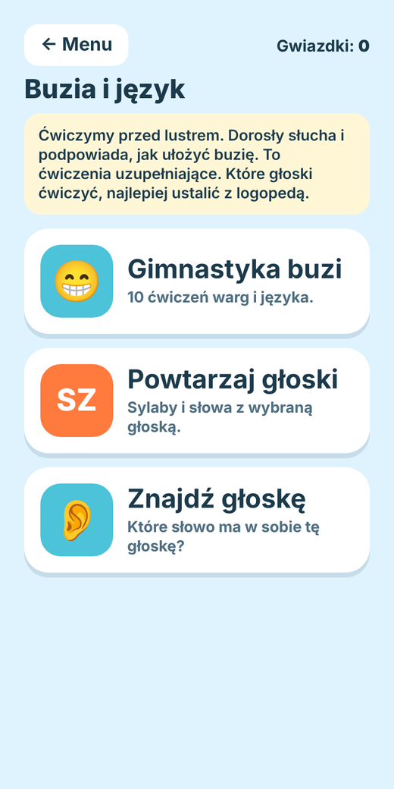

<div align="center">

# 🐸 Gadu Gierki

**Mini gry do nauki liczenia, czytania i mówienia dla dzieci w wieku 5–7 lat.**

Działa w przeglądarce, na telefonie i komputerze. Bez kont, bez reklam, bez serwera.


<br>


&nbsp;

&nbsp;


</div>

---

## Spis treści

- [Co jest w środku](#co-jest-w-środku)
- [Poziomy trudności](#poziomy-trudności)
- [Uruchomienie](#uruchomienie)
- [Testy](#testy)
- [Publikacja na Cloudflare Pages](#publikacja-na-cloudflare-pages)
- [Struktura projektu](#struktura-projektu)
- [Jak dodać własne słowa i ćwiczenia](#jak-dodać-własne-słowa-i-ćwiczenia)
- [Prywatność](#prywatność)
- [Licencja](#licencja)

## Co jest w środku

### 🔢 Liczenie

Dodawanie, odejmowanie albo oba naraz, zawsze w zakresie 1–10.

| Gra | Na czym polega |
| --- | --- |
| **Łap cyfry** | Z góry spadają cyfry. Trzeba złapać tę, która jest wynikiem, przesuwając koszyk palcem, myszką lub strzałkami (albo po prostu klikając cyfrę). |
| **Żaba do rodziny** | Żaba skacze po kamieniach do domu. Dobra odpowiedź to skok do przodu, zła cofa. Im wyższy poziom, tym więcej kamieni. |

### 🔤 Literki i czytanie

| Gra | Na czym polega |
| --- | --- |
| **Jaka to litera?** | Obrazek i słowo. Od jakiej litery się zaczyna? |
| **Złap sylabę** | Spadają sylaby (MA, TO, LE…). Trzeba złapać tę, o którą prosi gra. |
| **Ułóż wyraz** | Z rozsypanych literek układa się wyraz do obrazka. Zaczyna się od trzech liter, potem wyrazy rosną. |
| **Klocki sylab** | Każdy klocek to sylaba. Z klocków trzeba ułożyć cały wyraz, np. PIES → PIE + SEK. |

<p align="center">
  
  &nbsp;
  
  &nbsp;
  
</p>

### 👅 Buzia i język (ćwiczenia logopedyczne)

- **Gimnastyka buzi i języka**: 10 ćwiczeń z powtórzeniami (uśmiech, „koniuszek języka do nosa”…).
- **Powtarzaj głoski**: S, Z, C, SZ, Ż, CZ, R, L. Najpierw sylaby, potem słowa z podświetloną głoską.
- **Znajdź głoskę**: które słowo ma w sobie daną głoskę?

> Aplikacja nie rozpoznaje mowy: ocenia dorosły. To ćwiczenia uzupełniające, a które głoski ćwiczyć, najlepiej ustalić z logopedą.

<p align="center">
  
</p>

### 👧 Profile i postępy

- Do 6 dzieci, każde z własnymi wynikami i postępami na poziomach.
- Ekran **Postępy** dla rodzica: rekordy, ukończone poziomy, skuteczność w grach i ćwiczenia z ostatnich dni.
- Głos czytający słowa (przeglądarka, język polski) i dźwięki, które można wyłączyć jednym przyciskiem.

## Poziomy trudności

Wszystko jest dostosowane do dzieci w wieku 5–7 lat: spadanie jest wolne, a trudność rośnie stopniowo.

| Gra | Poziomy | Co rośnie |
| --- | :---: | --- |
| Łap cyfry | 20 | prędkość spadania (z ok. 22 do 80 px/s) i zakres liczb (od 1–5 do 1–10) |
| Złap sylabę | 20 | prędkość i trudność sylab, a od poziomu 7 także uzupełnianie brakującej sylaby |
| Żaba do rodziny | 20 | liczba kamieni (od 3 do 7) i zakres liczb |
| Ułóż wyraz | 30 | długość wyrazów: 3 litery (poziomy 1–12), potem 4, 5, 6 i 7 liter, oraz liczba zbędnych literek |
| Klocki sylab | 60 | po 20 poziomów dla wyrazów z 2, 3 i 4 klocków, w drugiej połowie serii dochodzi zbędny klocek |
| Jaka to litera? | 10 pytań | losowe obrazki |

W „Ułóż wyraz” i „Klockach sylab” wyrazy są **losowane przy każdym podejściu** z kilkudziesięciu słów,
więc dziecko nie dostaje ciągle tych samych. Kolejne poziomy odblokowują się po kolei
(rodzic może odblokować wszystkie jednym kliknięciem).

## Uruchomienie

Nie trzeba niczego budować. To zwykłe pliki statyczne, ale moduły ES nie działają po otwarciu
`index.html` z dysku (`file://`), więc potrzebny jest prosty serwer. W repozytorium jest gotowy, bez zależności:

```bash
git clone <adres-repozytorium>
cd gadu-gierki
npm start            # http://localhost:8080  (inny port: PORT=3000 npm start)
```

Wystarczy Node.js 18 lub nowszy. Można też użyć dowolnego innego serwera statycznego,
np. `python3 -m http.server`.

## Testy

```bash
npm install          # tylko jsdom, potrzebny do testów
npm test
```

Testy używają wbudowanego `node --test` i `jsdom`. Uruchamiają prawdziwy `index.html` z całą aplikacją
i „klikają” w gry jak dziecko. Pokrywają:

- dane (długość wyrazów, liczba sylab, unikalność, obrazki),
- generowanie zadań, poziomy i prędkości,
- przejście **wszystkich poziomów** każdej gry, z podpowiedziami i losowaniem słów,
- profile: osobne wyniki, zapis i odczyt po przeładowaniu, limit 6 dzieci, ochrona przed HTML w imieniu,
- działanie przy zablokowanym `localStorage`.

Na GitHubie testy uruchamiają się automatycznie przy każdym pushu
(workflow [`.github/workflows/test.yml`](.github/workflows/test.yml)).

## Publikacja na Cloudflare Pages

To strona statyczna bez budowania.

1. Wrzuć repozytorium na GitHub.
2. W panelu Cloudflare utwórz projekt **Pages** i połącz go z repozytorium (opcja Git).
3. Polecenie budowania zostaw puste, a katalog wyjściowy ustaw na katalog główny (`/`).
   Nazwy pól w panelu mogą się nieco różnić, sprawdź je w dokumentacji Cloudflare Pages.
4. Każdy push do głównej gałęzi publikuje nową wersję.

> Projekt Pages utworzony przez *Direct Upload* (wgrywanie plików) nie da się później przełączyć na integrację z Git.
> Jeśli chcesz używać GitHuba, od razu utwórz projekt z połączeniem do repozytorium.

Hosting działa też na GitHub Pages, Netlify i każdym innym hostingu plików statycznych.

## Struktura projektu

```
index.html             szkielet strony (wszystkie ekrany)
css/                   style podzielone tematycznie
js/
  main.js              punkt wejścia
  app.js               składa aplikację (createApp)
  data/words.js        słowa, sylaby, ćwiczenia i głoski
  lib/                 narzędzia: util, storage, audio, ui, questions, frog-svg
  features/            jedna gra lub funkcja na plik
tests/                 testy i pomocnik uruchamiający aplikację w jsdom
scripts/serve.mjs      lokalny serwer statyczny
docs/                  zrzuty ekranu do tego README
```

Każda funkcja to `initX(ctx)`, gdzie `ctx` jest wspólnym kontekstem (okno, dokument, zapis wyników,
dźwięk, przełączanie ekranów). Dzięki temu te same moduły działają w przeglądarce i w testach.
Frameworków nie ma, jest czysty JavaScript.

## Jak dodać własne słowa i ćwiczenia

Wszystkie dane są w [`js/data/words.js`](js/data/words.js):

| Lista | Format | Przykład |
| --- | --- | --- |
| `BUILD_WORDS` | słowa pogrupowane według liczby liter | `['KOT', '🐱']` w grupie `3` |
| `BLOCK_WORDS` | trzy serie (2, 3 i 4 sylaby), sylaby przez myślnik | `['PIE-SEK', '🐶']` w pierwszej serii |
| `WORDS` | słowo i obrazek do „Jaka to litera?” | `['ARBUZ', '🍉']` |
| `SOUNDS` | głoski do ćwiczeń logopedycznych | zobacz plik |

Po dopisaniu słów uruchom `npm test`. Testy sprawdzą, czy dane mają poprawny kształt
(np. czy wyraz w grupie `4` ma na pewno 4 litery, a w serii klocków właściwą liczbę sylab).

## Prywatność

- Imiona i wyniki zapisują się **tylko w przeglądarce** (`localStorage`), na tym urządzeniu.
- Nic nie jest wysyłane na żaden serwer. Nie ma analityki, kont ani reklam.
- Jedyne zewnętrzne żądanie to czcionki z Google Fonts.
- Dane dziecka można usunąć na ekranie **Postępy**.

## Licencja

[MIT](LICENSE). Obrazki w grach to emoji systemowe.
